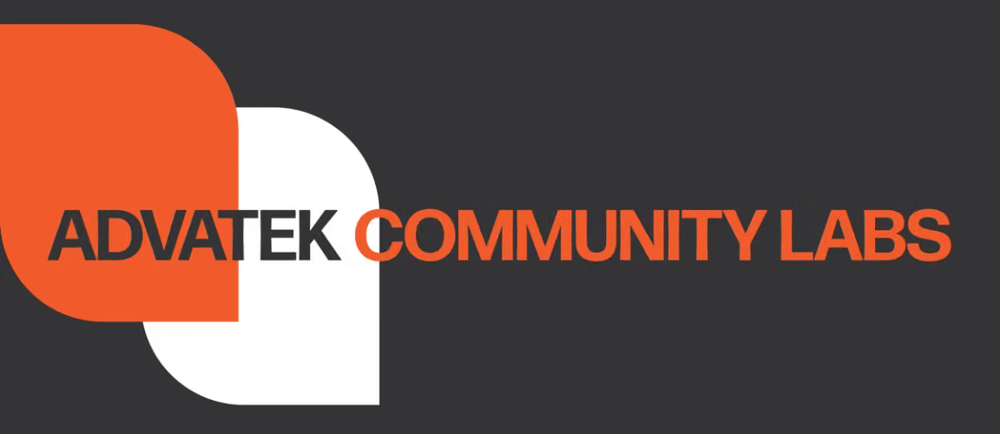

  

Community-driven projects, tools, and resources for Advatek products. Not officially supported by Advatek Lighting.

## Public projects

Community projects for Advatek products.

| Project | Status | Purpose |
| --- | --- | --- |
| [PixLite Mk3 Contact Trigger](https://github.com/advatekcommunitylabs/PixLite-Mk3-Contact-Trigger) | Community hardware project | Turns physical switches and relay contacts into PixLite Mk3 scene, playlist, intensity and test mode actions. |
| [PixLite Mk3 TouchDesigner](https://github.com/advatekcommunitylabs/PixLite-Mk3-TouchDesigner) | Community software project | Connects TouchDesigner to PixLite Mk3 controllers for real-time control and pixel-data workflows. |
| [PixLite Mk3 Loxone](https://github.com/advatekcommunitylabs/PixLite-Mk3-Loxone) | Work in progress | Product Management prototype to help customers and integrators explore native Loxone control of PixLite Mk3 SHOWTime. |

## Maintained upstream systems

Integrations distributed through other platforms. Check each repository for compatible versions, installation and support.

| **Project** | **Status** | **Purpose** |
| --- | --- | --- |
| [PixLite Mk3 for Bitfocus Companion](https://github.com/bitfocus/companion-module-advatek-pixlite-mk3) | Available in Companion | Discover controllers and control SHOWTime playback, intensity and colour, with device feedback. |
| [PixLite Mk3 for Node-RED](https://flows.nodered.org/node/@advatek-community-labs/node-red-pixlite-mk3) | Available in Node-RED Flow Library | Connects Node-RED to PixLite Mk3 controllers for SHOWTime playback control. |
| [PixLite Mk3 for Chataigne](https://github.com/JamesAdvatek/PixLite-Mk3-Chataigne) | Community beta ([catalogue](https://github.com/benkuper/Chataigne-community-modules)) | Trigger stored SHOWTime scenes and playlists from Chataigne, with playback controls and status feedback. |

## Support boundaries

Each repository explains its project and support status. Advatek Technical
Support does not cover these community projects unless a repository states
otherwise.

For Advatek Lighting products, official documentation and support, visit
[advateklighting.com](https://www.advateklighting.com).

## Contributing

Issues and pull requests are welcome where enabled. Check the target
repository's README and contributing guidance before proposing a change.

Contact Advatek to propose a new community project.

